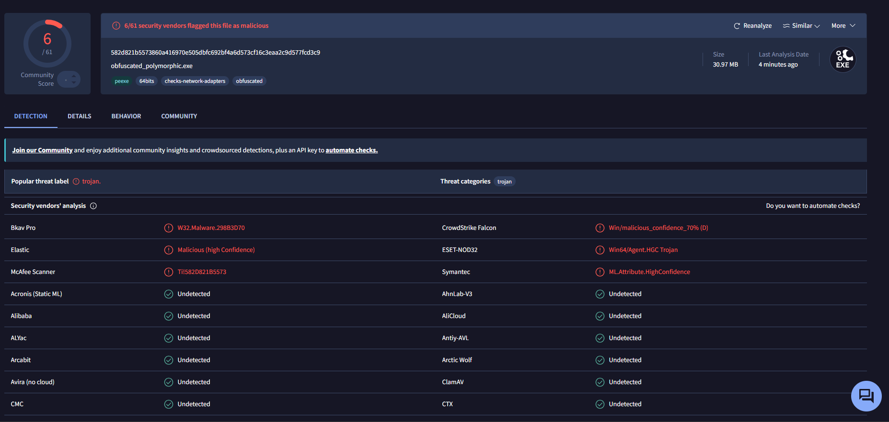

# GeniCrypter

A Rust-based PE crypter that encrypts a Windows x64 executable, embeds it into a self-contained stub, and executes it **in memory** without ever touching disk at runtime. The stub is compiled fresh for every target, carries its own decrypted payload, and includes a set of low-cost anti-analysis and behavioral-misleading features.


## Table of Contents

- [Features](#features)
- [Detection Results](#detection-results)
- [Limitations](#limitations)
- [Architecture](#architecture)
- [Requirements](#requirements)
- [Installation](#installation)
- [Usage](#usage)
- [Generated Files](#generated-files)
- [TODO](#todo)
- [Disclaimer](#disclaimer)

## Features

- **AES-256-GCM encryption** of the target PE, with the key derived from an `ENCRYPTION_KEY` passphrase via HKDF-SHA256 and a random nonce.
- **zstd compression** of the ciphertext before embedding — keeps the stub binary smaller than the raw target.
- **Compile-time embedding** — the encrypted payload, padding, and configuration constants are compiled into the stub with `include_bytes!` / a generated Rust file. The final `obfuscated.exe` is fully self-contained and has no runtime file dependencies.
- **In-memory execution** — the stub decrypts the target and maps it into its own process via `maple-rs`. No temporary file is written to disk.
- **Configurable execution delay** — the stub can wait before running the target. The delay is filled with real CPU/memory work (`busywork`) instead of a static `sleep`, to break the "idle then act" behavioral signature.
- **Randomized detection-response delay** — when a VM or debugger is detected, the stub performs 60–120 seconds of benign work before exiting, instead of quitting immediately.
- **Analysis environment detection** — uses the `antilysis` crate, which performs a single combined check covering:
  - **Debuggers** — via `IsDebuggerPresent`, `CheckRemoteDebuggerPresent`, and the `\\.\NTICE` device (SoftICE); plus scanning the process list for `x64dbg.exe`, `WinDbg.exe`, `ollydbg.exe`, `gdb.exe`, `procdump.exe`, and others.
  - **Suspicious analysis processes** — `Wireshark.exe`, `procexp64.exe`, `Procmon64.exe`, `pestudio.exe`, `pe-sieve64.exe`, `hollows_hunter32.exe`, `Moneta64.exe`, `fakenet.exe`, `tcpview.exe`, `dumpcap.exe`, and others.
  - **VM guest processes** — `VBoxTray.exe`, `VBoxService.exe`, `vmtoolsd.exe`, `VMwareUser.exe`, `qemu-ga.exe`, `vdagent.exe`, `xenservice.exe`, and others.
  - **VM driver files** — VMware (`vmmouse.sys`, `vmhgfs.dll`, `vmGuestLib.dll`, ...) and VirtualBox (`VBoxMouse.sys`, `VBoxGuest.sys`, `VBoxSF.sys`, ...) under C:\Windows\System32\Drivers\.
  - **VM MAC address prefixes** — `00:05:69`, `00:0C:29`, `00:1C:14`, `00:50:56` (VMware) and `08:00:27` (VirtualBox).
  - **Sandbox artifacts** — hostname and Windows version heuristics.
- **String obfuscation** — log messages and other literals are obfuscated at compile time with `obfstr`, so they do not appear in plaintext under `strings`.
- **File size padding** — optional `--add-size` injects random bytes into the stub at compile time, so the binary carries no zero-filled or high-entropy "overlay" block.
- **Optional GUI subsystem** — the stub can be linked as a GUI PE to avoid the console window flash when the target is a GUI application.
- **Cleanup** — intermediate files in the stub directory (`payload.enc`, `padding.bin`, `generated.rs`) are removed after a successful build.

## Detection Results

The generated binary was scanned on VirusTotal: **6 out of 61 security vendors** flagged it.



> **This is not a guarantee.** VirusTotal aggregates many engines, and results depend on the exact target, the key, the build, and when the scan was run. Detection rules and machine-learning models are updated continuously. A sample that is clean today may be flagged tomorrow. See the [Disclaimer](#disclaimer).

## Limitations

- **Windows only.** The stub uses Windows-specific APIs (`maple-rs` manual mapping, `anti_debug`, `antilysis`). It will not build or run on Linux or macOS.
- **x64 only.** The loader currently relies on `maple-rs`, which is 64-bit only. 32-bit (x86) targets are **not supported**. The stub and the target must both be x64.
- **`maple-rs` is not a full Windows loader.** It manually maps the PE image but does not reproduce every side effect of the real loader. Targets that depend on:
  - kernel drivers (e.g. Procmon),
  - DLLs located in their own install directory (e.g. Chrome),
  - elevation/UAC manifests,
  - or other runtime environment expectations,

  may fail to start. For such targets, set the DLL search path (`SetDllDirectoryW`) or accept that in-memory loading is not appropriate.
- **The AES key lives in the generated stub source.** It is embedded into the stub binary and can be recovered by a determined reverse engineer. The encryption protects against static inspection, not against a targeted analysis of the stub.
- **Obfuscation is not applied by default.** The stub is compiled with plain `cargo build --release`. LLVM-pass obfuscation (e.g. `ollvm-rust`, Amice) can be added to `build_stub`, but it is not wired in yet.
- **Anti-debug and anti-VM checks are heuristics.** They can produce false positives (legitimate VMs, security software) and false negatives (hardened analysis environments). They are a first layer of defense, not a guarantee.


## Architecture

```text
evasion/
├── crypter/ # the evasion CLI — runs on the build machine
│ ├── src/
│ │ ├── main.rs # pipeline orchestration
│ │ ├── parser.rs # clap CLI definition
│ │ └── pkg.rs # env limits, PE validation, key derivation, logging
│ └── Cargo.toml
└── stub/ # the loader — compiled fresh for every target
├── src/
│ ├── main.rs # anti-analysis, decrypt, execute
│ ├── logger.rs # colored log helpers
│ └── generated.rs # overwritten by the crypter before every build
├── build.rs # creates placeholder payload/padding if missing
├── payload.enc # written by the crypter (embedded at compile time)
├── padding.bin # written by the crypter (embedded at compile time)
└── Cargo.toml
```

### Pipeline

1. `crypter` reads the target PE and encrypts it with AES-256-GCM.
2. The ciphertext is zstd-compressed.
3. `crypter` writes `stub/payload.enc`, `stub/padding.bin`, and `stub/src/generated.rs` (`KEY`, `NONCE`, `DELAY_SECS`, `VERBOSE`, `ANALYSIS_DETECTION`).
4. `crypter` runs `cargo build --release` inside `stub/`. `include_bytes!` and `mod generated` pick up the real data and constants.
5. The built `stub.exe` is copied to the user-specified `--output` path.
6. Intermediate files in `stub/` are removed.

### Runtime flow (inside the generated stub)

1. Optionally run `busywork` if a analysis is detected, then exit.
2. Optionally wait `DELAY_SECS`, filled with `busywork`.
3. Decompress `payload.enc`.
4. Decrypt the ciphertext with `KEY` / `NONCE`.
5. Map the decrypted PE into the current process with `maple-rs` and jump to its entry point.

## Requirements

- **Windows** (build and run).
- **Rust** (stable toolchain; nightly only if you add LLVM obfuscation).
- **Visual Studio Build Tools** with the "Desktop development with C++" workload (MSVC linker).
- A `.env` file at the crypter's working directory containing:

  ```env
  MAX_FILE_SIZE_MB=200 # between 0 and 350 to avoid memory issues
  MAX_DELAY_SECONDS=500 
  MAX_PADDING_MB=200 # between 0 and 250 to avoid memory issues
  ENCRYPTION_KEY="secret_key"
  ```
  MAX_* values are optional and fall back to the defaults shown.

## Installation

```powershell
  git clone <repo-url> GeniCrypter
  cd GeniCrypter\evasion\crypter
  cargo build --release
```

## Usage
```powershell
  .\target\release\evasion.exe --help
```

```powershell
  A Windows binary crypter featuring configurable file size, anti-debugging, virtual machine detection, and execution delay options.

  Usage: Evasion [OPTIONS]

  Options:
    -t, --target-binary <target-binary>  
    -o, --output <output-binary>         
    -s, --padding <size-in-mb>           [default: 0]
    -d, --delay <seconds>                [default: 60]
    -v, --verbose                        
    -a, --anti-analysis                   
    -V, --version                        Print version
```

#### Example:

```powershell
  .\target\release\evasion.exe --encrypt ..\target\hello.exe --output ..\obfuscated_hello.exe --add-size 0 --delay 5
``` 

#### Run the result:
```powershell
  .\obfuscated_hello.exe
```


# Generated Files

The crypter creates the following files in **stub/** before compiling it, and removes them after a successful build:

| File | Purpose |
|---|---|
| ``payload.enc`` | zstd-compressed, AES-256-GCM-encrypted target PE. Embedded by ``include_bytes!``. |
| ``padding.bin`` | Random bytes of size ``--add-size`` MiB. Embedded by ``include_bytes!`` to inflate the binary. |
| ``src/generated.rs`` | ``KEY``, ``NONCE``, ``DELAY_SECS``, ``VERBOSE``, ``ANALYSIS_DETECTION`` as Rust constants. |

``stub/build.rs`` creates empty placeholders for ``payload.enc`` and ``padding.bin`` if they are missing, so the stub can be built standalone during development. ``stub/src/generated.rs`` should be committed with placeholder values for the same reason — the crypter overwrites it before each real build.

## TODO
- Optional remote retrieval of the decryption key.
- A standalone runner that does not depend on the crypter.
- More VM and debugger detection checks.
- A nesting/depth option for generated stubs.
- Further investigation of manual mapping and API-hooking approaches.

These are planned items, not implemented features.

## Disclaimer

This project is intended for **educational and authorized security research only**. It demonstrates how PE encryption, in-memory loading, and anti-analysis techniques work under the hood. Do not use it to distribute malware, evade detection on systems you* do not own, or otherwise violate applicable laws or terms of service.

The author is not responsible for any misuse or damage caused by this software. Running in-memory PE loaders may trigger antivirus or EDR alerts on the build and test machines — this is expected behavior, not a bug. Test only in isolated virtual machines that you control.